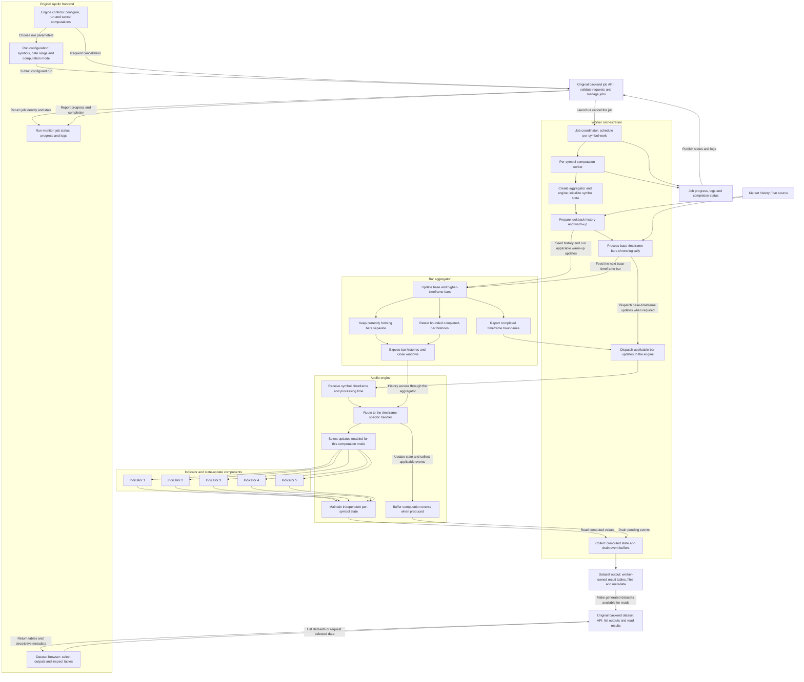
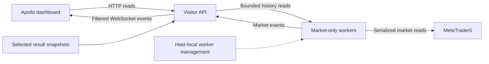

# Apollo — backend

A read-only edition of the original Apollo backend, prepared for public release.
It powers the Apollo dashboard with selected OHLCV history, filtered live market
events and selected result tables, without the original private operator API,
trading execution or strategy computation.

## Tech stack

| Layer                         | Technology                         |
| ----------------------------- | ---------------------------------- |
| API runtime                   | Python, FastAPI, Pydantic, Uvicorn   |
| Market connection             | MetaTrader5 on Windows              |
| Data processing and transport | pandas, PyArrow, HTTPX              |
| Live delivery                 | WebSocket                          |
| Testing                       | Python unittest, synthetic fixtures |

## Engine tech stack

The original Apollo computation engine uses the following stack. These private
computation components are not bundled with the read-only backend.

| Layer | Technology |
| --- | --- |
| Engine runtime | Python, custom event-driven computation |
| Numerical and tabular processing | NumPy, pandas |
| Bar aggregation and history | Custom Python aggregator, bounded `collections.deque` histories |
| Parallel computation | `multiprocessing`, `concurrent.futures.ProcessPoolExecutor` |

## Engine design

The original Apollo computation pipeline separates job orchestration, per-symbol
workers, timeframe aggregation and engine-driven indicator updates:

- **Frontend controls submit jobs, not direct engine calls.** The original UI
  collects run parameters and requests computation or cancellation through the
  backend job API. It follows the returned job identity to display progress,
  logs and completion status; it does not create engine instances in the browser.
- **Workers own execution.** A job coordinator schedules per-symbol tasks. Each
  computation worker prepares its history, initializes an engine and aggregator,
  advances the processing loop, and collects results. The engine does not manage
  the worker pool or write result files itself.
- **The aggregator owns bar construction.** It builds the selected timeframes
  from the worker's base stream, keeps forming bars distinct from completed
  history, and reports timeframe closures. Base timeframes and lookback needs
  vary by computation; not every worker runs an M1 replay.
- **The engine owns computation state.** Workers call `on_bar` with the symbol,
  applicable timeframe and processing time. The engine routes that update to a
  timeframe handler, reads the aggregator's history views and updates the
  components enabled for the selected mode. Indicators are not all recomputed
  on every bar, and forming bars are not interchangeable with completed bars.
- **Results return through state and events.** Workers read the engine's
  per-symbol state and drain relevant event buffers to build their output tables.
  Progress, logs and final job status remain worker-orchestration responsibilities.
- **Datasets are a separate read path.** Workers save generated result tables and
  associated metadata. The dataset API exposes listings and selected data to the
  frontend browser; viewing a dataset does not rerun the computation engine.

This is a conceptual view of the **original Apollo computation engine**, not the
read-only runtime below. It omits strategy formulas, thresholds and execution
rules. The computation controls, private engine, indicator-computation workers
and original research outputs are not included in this edition. Its dashboard
uses the read-only visitor API below, and its market-only workers serve history
and live market events without running this pipeline.

## System design

The visitor API and internal worker callbacks share one backend runtime and
registry. Worker management stays local to the Windows host; browser requests
cannot start or stop workers.

## Responsibilities

- Serve only explicitly selected symbols, source aliases and result tables.
- Bound history and result reads and filter live events by source and symbol.
- Provide immutable, indexed result snapshots with masked-template support.
- Deny visitor writes and private routes independently of dashboard controls.
- Omit computed period-level overlays; `/levels/{symbol}` is not a visitor route.

## Integration

The dashboard requests data from the visitor API rather than connecting directly
to MT5 or worker endpoints. Browser origins and source/result selections are
explicitly configured on the host. Missing or unselected sources do not fall back
to another worker or a synthetic feed.

The market-only workers provide no order, positions or account-history routes.
Private trading adapters, strategy computation, original research datasets,
credentials, terminal configuration and original repository history are excluded.
No live service, broker connection or dataset is bundled or started by installation.
Synthetic contract fixtures are test data, not live market data or selected
showcase templates.

## Verification and source terms

See [verification](docs/verification.md) for the synthetic checks and publication
boundary. This repository is source-only: publishing it does not deploy, update or
connect to any running backend. Live MT5 operation requires a separately prepared
Windows host; the private host setup and actual configuration are not included.

First-party source is available for portfolio inspection under [these terms](LICENSE.md),
not an open-source reuse licence. Third-party dependencies retain their own licences;
see [notices](THIRD_PARTY_NOTICES.txt).
